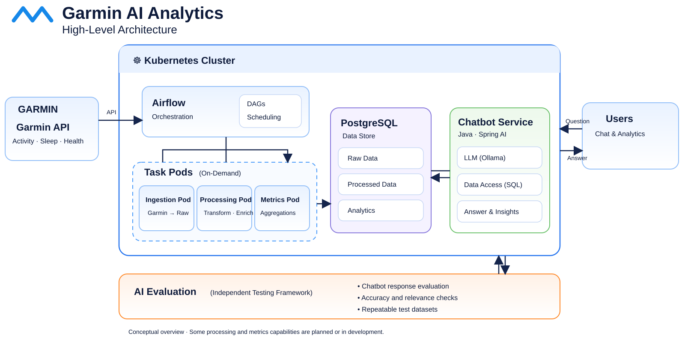

# Garmin AI Analytics

**Your data. Your insights. Your goals.**

A free, community-driven platform that helps Garmin users better understand their activity, recovery and health trends through data analytics and AI.

- **For Garmin users** — understand what your data means, not just see numbers
- **For developers** — contribute to a real open-source AI and data engineering platform
- **For personal development** — explore how data and AI can help people pursue measurable goals

## Current status

**Local prototype under active development.** The first milestone is an
end-to-end Garmin data and AI explanation demo; public multi-user access is a
future goal.

Daily-summary and sleep ingestion preserve original JSON; daily summaries are
loaded into PostgreSQL. The React chat uses Spring Boot and Spring AI to select
supported scalar analyses and explain calculated results with data coverage.
Sleep is currently archived only. Real-model testing still finds routing and
factual explanation failures; reliable answers remain an active work item.

[Product vision](https://github.com/andreysirak/garmin-ai-analytics/issues/44) ·
[First demo](https://github.com/andreysirak/garmin-ai-analytics/issues/18) ·
[Project board](https://github.com/users/andreysirak/projects/2)

## Architecture

### High-Level System Architecture

Conceptual overview of the platform. Some processing and metrics capabilities remain planned or in development.

### Detailed architecture

The [architecture guide](docs/architecture.md) contains the current Airflow DAG, planned AI workflow and their implementation status. For component-level details, see the [ingestion guide](docs/ingestion-guide.md), [chat documentation](garmin-chat/README.md) and [AI evaluation framework](ai-evaluation-framework/README.md).

> **Open analytical goal:** “Do days with more physical activity tend to be followed by better-quality sleep?” This requires validated overnight sleep data, supported quality indicators, next-night pairing and statistical analysis; longer sleep alone does not establish better quality.

## Run locally

The stack runs in kind, including Airflow, PostgreSQL, React, Spring Boot and
CPU-based Ollama. Initial guidance is a host with **16 GiB RAM and 8 logical CPUs**,
with **4 CPUs / 8 GiB RAM** allocated to the container VM. This is starting
guidance from a bounded local check, not a verified minimum or stress-test result.

1. Follow the [installation guide](docs/getting-started.md) to install tools,
   configure private credentials and prepare storage. After configuration,
   `make stack-up` deploys PostgreSQL and Airflow.
2. [Run the ingestion pipeline](docs/ingestion-guide.md#4-run-the-pipeline)
   through the Airflow UI.
3. Follow the [chat setup](garmin-chat/docs/setup.md) for its read-only database
   credentials and deployment settings, then run `make chat-up` to deploy and
   forward the frontend. Keep the forwarding terminal open.

Existing installations must follow the
[storage migration and rebuild guidance](docs/database-storage.md) before
changing database storage. Keep credentials and personal Garmin data out of Git.

## Technology stack

| Layer | Technologies |
| --- | --- |
| Ingestion and orchestration | Java 25, Maven, JDK HTTP Client, Jackson; Airflow 3, Python DAGs, LocalExecutor, KubernetesPodOperator |
| Chat backend | Spring Boot 3.5, Spring AI 1.1, Spring JDBC, Bean Validation, Actuator |
| Chat frontend | React 19, JavaScript, Vite, Nginx |
| Local inference | Ollama, quantized Qwen 2.5 1.5B Instruct |
| Storage and analytics | PostgreSQL, JSONB staging, read-only parameterized SQL; original JSON archives and success markers |
| Runtime and deployment | Kubernetes, kind, Docker, Colima or Docker Desktop; Helm, Kustomize, Make |
| Security | Kubernetes Secrets, RBAC, ValidatingAdmissionPolicy, dedicated database roles |
| Verification and CI | JUnit 5, Mockito, Spring Boot Test, pytest, Vitest, React Testing Library, Ruff, SpotBugs, PMD; GitHub Actions |

Why these choices? See the decisions on
[Java ingestion](docs/decisions/0002-java-garmin-data-ingestion.md) and
[local Kubernetes and cloud migration](docs/decisions/0001-kubernetes-execution.md).
Cloud portability guides component boundaries; moving to managed services will
still require changes to storage, IAM, secrets and execution settings.

## Quality and evaluation

Code, SQL and model behaviour need different checks. Java/Python and infrastructure
checks run in GitHub Actions; a separate Airflow smoke workflow is manually
triggered. Chat verification commands are documented in the
[chat verification guide](garmin-chat/docs/testing.md#offline-verification) and
[contribution guide](CONTRIBUTING.md).

### AI evaluation architecture

The [independent AI evaluation framework](ai-evaluation-framework/README.md) documents its own [architecture diagram](ai-evaluation-framework/assets/approved-evaluation-architecture.svg), versioned synthetic cases and repeatable checks. The [controlled model evaluation](docs/evaluations/2026-11-19-garmin-chat/README.md) records observed routing and explanation failures. Offline tests do not establish real-model answer quality.

## Roadmap

The next steps build on ingestion, JSONB staging and the first chat integration:

- Establish repeatable AI regression evaluation and improve natural-language
  routing and answer reliability ([#74](https://github.com/andreysirak/garmin-ai-analytics/issues/74),
  [#66](https://github.com/andreysirak/garmin-ai-analytics/issues/66)).
- Measure and improve chat latency ([#67](https://github.com/andreysirak/garmin-ai-analytics/issues/67)).
- Extend historical backfill and data-quality checks; normalize staged data
  into reusable analytical datasets.
- Add derived processing, overnight sleep staging and correctly aligned
  activity/sleep statistics.
- Build automated insights and recommendations grounded in validated analytics.

Future processing includes Apache Beam. Public access and multi-user capabilities
remain future work. See the [project board](https://github.com/users/andreysirak/projects/2)
for tracked investigations and tasks.

## Documentation

Start with the [documentation index](docs/README.md), grouped by task.

| I want to… | Read |
| --- | --- |
| Install the local stack | [Getting started](docs/getting-started.md) |
| Configure Colima/Docker or investigate scheduling | [Local operations](docs/local-operations.md) |
| Understand the recorded capacity measurements | [Local capacity check](docs/verification/0076-local-capacity-reference.md) |
| Run or develop ingestion | [Ingestion guide](docs/ingestion-guide.md) |
| Deploy or verify the chat | [Garmin chat](garmin-chat/README.md) |
| Understand components and boundaries | [Architecture](docs/architecture.md) |
| Configure accounts and credentials | [Credentials](docs/credentials.md) |
| Manage PostgreSQL, backups or a cluster rebuild | [PostgreSQL](docs/postgresql.md) · [Persistent storage](docs/database-storage.md) |
| Understand past decisions and failures | [Ingestion retrospective](docs/retrospectives/0001-garmin-api-integration.md) · [AI chat retrospective](docs/retrospectives/0002-ai-chat-integration.md) |
| Contribute or review changes | [Contribution guide](CONTRIBUTING.md) · [Changelog](CHANGELOG.md) |

## Contributions welcome

Interested in Java, Python, Airflow, Kubernetes, or data engineering? Contributions are welcome, from focused bug fixes and tests to documentation improvements. Explore the [open issues](https://github.com/andreysirak/garmin-ai-analytics/issues), propose an improvement, or submit a pull request. No invitation is needed—see [CONTRIBUTING.md](CONTRIBUTING.md) for a friendly first-contribution guide and review expectations.

## Project philosophy

Build incrementally, with clear component boundaries, testable business logic, data integrity, and operational reliability. Add infrastructure only where it serves a practical need.

This is an independent learning and portfolio project, **not a medical diagnosis or treatment service**.

Links for existing README bookmarks

Operational sections have moved. These anchors keep earlier README links useful.

- [Quick start](docs/getting-started.md#quick-start)

- [Prerequisites](docs/getting-started.md#prerequisites)

- [1. Configure credentials once](docs/getting-started.md#1-configure-credentials-once)

- [2. Prepare the cluster](docs/getting-started.md#2-prepare-the-cluster)

- [3. Deploy PostgreSQL and Airflow](docs/getting-started.md#3-deploy-postgresql-and-airflow)

- [One-command alternative](docs/getting-started.md#one-command-alternative)

- [Local hardware and VM capacity](docs/local-operations.md#local-hardware-and-vm-capacity)

- [Colima and Docker configuration](docs/local-operations.md#colima-and-docker-configuration)

- [CPU scheduling and troubleshooting](docs/local-operations.md#cpu-scheduling-and-troubleshooting)

- [Verified local configuration (2026-11-17)](docs/verification/0076-local-capacity-reference.md#verified-local-configuration-2026-11-17)

- [4. Run the pipeline](docs/ingestion-guide.md#4-run-the-pipeline)

- [Development and verification](docs/ingestion-guide.md#development-and-verification)

