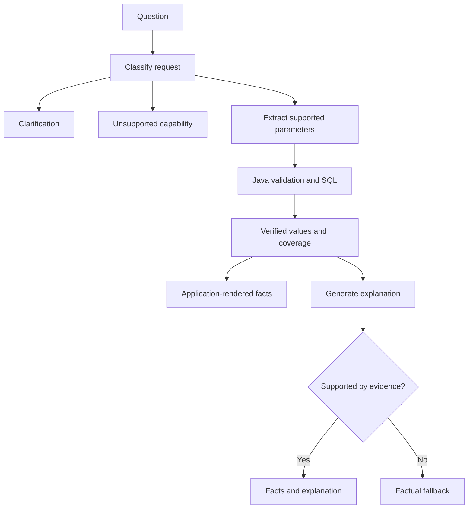

# Garmin chat workflow reliability — implementation plan

Status: **planning only; no runtime changes implemented in this follow-up**.

Tracks [#66](https://github.com/andreysirak/garmin-ai-analytics/issues/66).
Performance measurement remains in [#67](https://github.com/andreysirak/garmin-ai-analytics/issues/67).
Built on [PR #68](https://github.com/andreysirak/garmin-ai-analytics/pull/68).
Baseline: [19 November controlled evaluation](../evaluations/2026-11-19-garmin-chat/README.md).

## Goal and selected approach

Retain an application-controlled **workflow**, combining routing with sequential
model calls and deterministic Java/SQL execution. Prefer measured changes to
the existing Spring Boot service over an autonomous agent or additional services.

Current code combines route selection and parameter extraction in one model call,
executes accepted scalar selections in Java, then asks the model to explain
compact evidence. The evaluation found semantic routing failures and unsupported
explanations despite completed inference and valid query parameters.

## First checkpoint: isolate routing failure

- Freeze a reviewed rubric distinguishing wrong intent, unsupported capability,
  invented periods, invalid parameters and useful clarification.
- Evaluate the existing combined contract against a route-only contract, then
  compare constrained and unconstrained output under controlled conditions.
- Reuse the same questions, catalog, reference date and repetitions. Change one
  factor at a time; record model digest, prompt/schema/template and settings.
- Verify that structured-output or template behavior is not driving every
  question into ANALYZE before attributing all failures to model size.
- Compare one approved stronger local model using identical frozen inputs.
  Installation, resource changes and live inference are separate execution steps.
- Record outcomes even if no candidate/configuration meets the rubric. Do not
  silently replace historical evidence or claim a successful comparison in advance.

## Implementation checkpoints after measurement

1. Keep or split classification and parameter extraction based on measured
   accuracy and latency, rather than assuming another model call is beneficial.
2. Keep metric allowlists, date limits, server-side profile selection and fixed
   read-only parameterized SQL. Preserve missing, null, invalid and zero readings.
3. Present authoritative values, units, dates and coverage independently of
   generated commentary. An incomplete sum must be identified as partial.
4. Evaluate bounded explanation checks and a factual fallback. Type-safe output
   or an LLM evaluator alone is not proof that prose follows the evidence.
5. Expand synthetic unit fixtures and explicitly run live model evaluations;
   neither substitutes for the other.

## Proposed flow

This diagram is a candidate refinement, **not the implemented call graph**.
Whether classification and extraction need separate calls is an evaluation decision.

## Code and documentation boundaries

Use injected components with focused responsibilities and testable service
boundaries: interpretation, validation/execution, evidence presentation,
explanation and acceptance. Evolve existing components where appropriate.
Do not introduce question-specific regex rules or duplicate catalog definitions.

Update the main README and AI architecture documentation with:
- the actual implemented ingestion/chat topology;
- a request-flow diagram distinguishing model decisions from Java/SQL execution;
- implemented, experimental and planned capability labels;
- links to dated evaluation results, with limitations and privacy exclusions;
- proposed diagrams clearly separated from implemented behavior.

No raw personal Garmin data, generated health-data narratives or credentials
belong in repository fixtures or public evaluation artifacts.

## Out of scope

No arbitrary model-generated SQL, RAG/vector store, MCP service, multi-agent
orchestrator, conversation memory or infrastructure topology redesign.
Next-night activity/sleep relationships require the separate sleep foundation
in [#17](https://github.com/andreysirak/garmin-ai-analytics/issues/17); scalar
calendar-day sleep summaries must not be presented as that capability.

## Branch and review lifecycle

This branch starts at parent PR #68's head and initially targets
`feat/66-chat-diagnostics`. The owner merges the parent into `main`, then
retargets this draft PR. Inspect the resulting diff, especially after a squash
merge: inherited parent commits may appear and require a separately authorized
branch realignment. Do not delete the parent branch before retargeting.

This plan is a review checkpoint, not evidence of implementation or acceptance.
Do not close #66 or #67 based on this scaffold.
