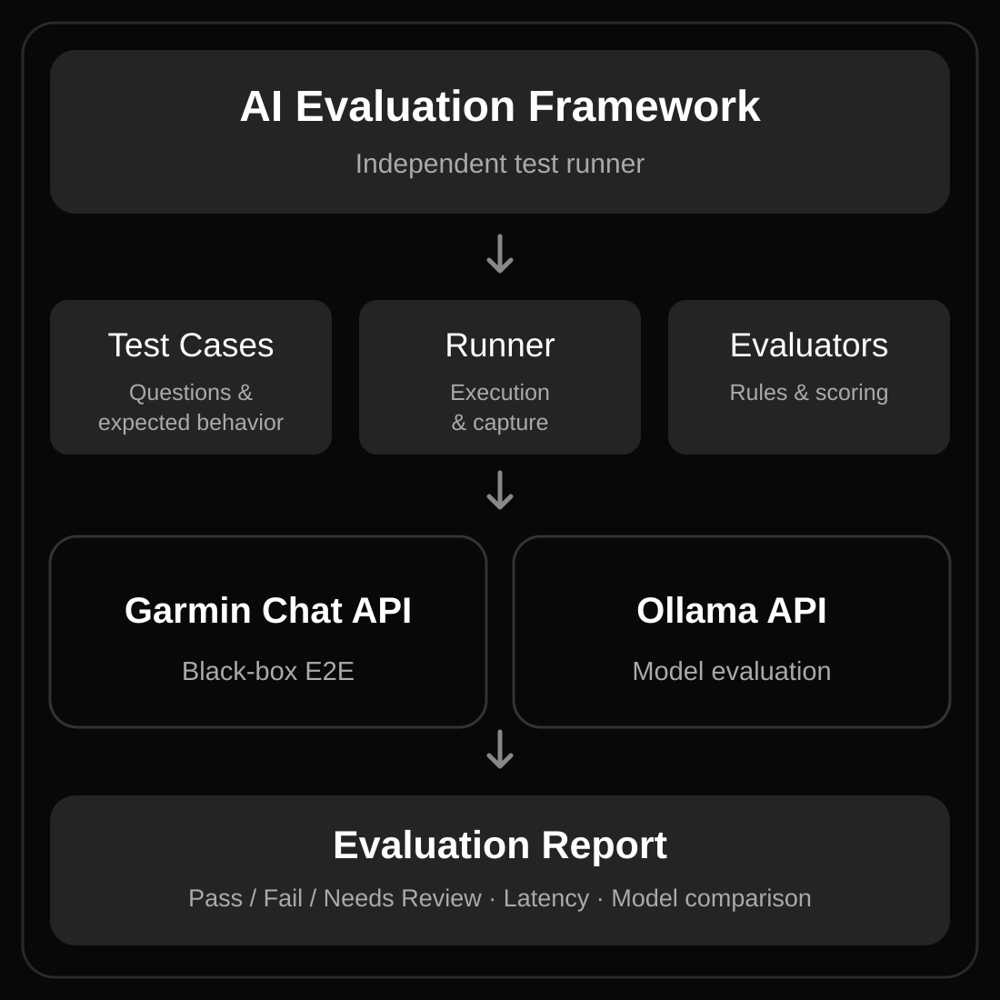

# Testing the Garmin chatbot

This suite answers: **did a model, prompt or workflow change make our chatbot
better or break something that worked before?** It uses invented Garmin readings,
not your personal records or Garmin API key.

Start here. The [test-case catalogue](TEST-CASES.md) describes every question and
expected outcome. The [technical reference](REFERENCE.md) explains the capture
format, detailed grading rules, baseline restrictions and remaining limitations.
Tracked in [#74](https://github.com/andreysirak/garmin-ai-analytics/issues/74).

## Approved target architecture — planned refactoring

> **Architecture decision (approved by project owner, 20 November 2026).** The diagram below is the agreed **target design**, not a claim that the existing suite already implements these boundaries. This documentation-only stage precedes the refactoring. The diagram is a repository-renderable recreation of the reviewed architecture sketch.



**Architectural goal:** a standalone, implementation-agnostic **AI Evaluation Harness**. It must remain usable if Garmin Chat replaces Spring AI, Ollama or the entire backend implementation. Spring AI belongs to the application, **not** to the framework's core dependencies. The framework can live in this monorepo while remaining logically independent; a separate repository is not required for independence.

### Testing boundaries and terminology

| Layer | Purpose | Coupling | Location / status |
| --- | --- | --- | --- |
| Unit tests | Deterministic date, catalog, validation and orchestration logic | May import production classes | Remain in backend test sources; existing |
| Integration / component tests | Real SQL, Spring components, prompt/decoder contracts and test-only Java bridge | Deliberately white-/gray-box | Existing; keep separate from black-box acceptance |
| Application E2E | Send a user question through public `/api/chat` and inspect the response | **Black-box**; no imports of application internals | Existing HTTP capture is preliminary; full automatic factual verification **planned** |
| Model evaluation | Run frozen questions and evidence against a model/provider endpoint | Model adapter only, not application code | Existing Ollama mode; provider-neutral adapters **planned** |
| Trace-based flow evaluation | Assert routing, SQL execution count, evidence and explanation sequence | **Gray-box** via a stable, versioned diagnostic-event contract, not Java imports or arbitrary log strings | **Planned** |
| AI quality evaluation | Grade semantic routing, factual accuracy, coverage, relevance, unsupported claims and regressions | Versioned rubric, independent synthetic oracle | Deterministic checks and human review exist; expansion **planned** |

**Target component responsibilities** (names express roles, not a mandate to create one class per row):

- **Test Cases / Dataset:** versioned questions, synthetic evidence, expected behavior and acceptance rubric; independent of runner and provider.
- **Runner:** execute a case/repetition with deadlines, capture immutable provenance and return an execution record; do not implement grading.
- **Transport ports and adapters:** application HTTP and model endpoints behind small interfaces. Ollama is one adapter, not the core abstraction.
- **Evaluators:** deterministic assertions and separate reviewable semantic criteria; do not invoke the application implicitly or silently convert uncertain answers into passes.
- **Reporting / comparison:** summarize PASS / FAIL / ERROR / NEEDS_REVIEW, latency and comparable model/configuration regressions without changing captured results.
- **Optional diagnostic trace adapter:** consume a documented, stable event schema for flow assertions. A black-box run must remain possible without this adapter.

### SOLID and Clean Code refactoring rules — next implementation stage

1. **SRP:** separate dataset loading, execution, transport, validation/grading, review and reporting. Keep classes/functions cohesive and small without creating needless wrappers.
2. **OCP / DIP:** introduce explicit ports for application/model transports and evaluator strategies; the runner depends on abstractions, not Spring AI, Ollama or Garmin Chat internals.
3. **LSP / ISP:** keep adapter contracts narrow and substitutable; provider-specific fields belong in adapters or optional metadata, not mandatory core interfaces.
4. **Clean boundaries:** no imports from `garmin-chat/backend` in the independent core; retain the existing Java bridge only in a clearly isolated component/contract-testing adapter where production fidelity is useful.
5. **Preserve behavior:** keep existing case IDs, fixtures, review states, privacy controls, immutable captures, baseline comparability and CLI commands unless an explicitly reviewed migration is necessary.
6. **Incremental delivery:** first review the dependency map and proposed module layout; then move responsibilities in small independently testable steps. Run existing offline checks after each step. **No refactoring or production changes are part of this documentation update.**

### LLM-as-a-Judge — planned, not enabled

A future optional evaluator may use an LLM to **propose** relevance, groundedness and unsupported-claim judgments. This is **not** the next implementation step and **must not** replace deterministic arithmetic, schema/route assertions, synthetic oracle checks or human adjudication. Any judge needs an explicit model/version, calibrated rubric, provenance, reviewable rationale, reproducibility controls and separate failure classification. Never treat a model judging its own answer as independent proof.

The Spring AI [evaluation testing documentation](https://docs.spring.io/spring-ai/reference/api/testing.html) provides relevant evaluation concepts, and its [LLM-as-a-Judge guide](https://docs.spring.io/spring-ai/reference/guides/llm-as-judge.html) describes an optional approach. **Neither API is a required dependency of this standalone harness**; consult documentation matching the pinned Spring AI version before any application-side integration.

**Delivery boundary:** this PR stage records the approved design only. The next stage is the SOLID / Clean Code refactor, followed by separately verified trace-based E2E acceptance and (later) optional judge research.

### Refactoring implementation status (20 November 2026)

The second-stage refactor has **started on this PR branch**. The initial
behavior-preserving extraction separates single-trial execution and stage grading
(`trial.py`) from run orchestration (`capture.py`), and isolates Ollama
model identity/provenance (`ollama.py`). The trial executor accepts a transport
port and an optional route validator; application HTTP trials no longer instantiate
the Java test bridge. Focused contract tests have been added.

**Not yet complete:** model-mode prompt export/validation still deliberately uses
the Java bridge, and the run orchestration, provenance, CLI, storage and report
modules still require further SOLID/Clean Code review. Application runs still
query Ollama for provenance and require a synthetic deployment. Structured trace
ingestion, provider-neutral model discovery and optional LLM-as-a-Judge remain
planned. The Make wrappers still prepare the Java bridge; removing that unnecessary
step for application-only runs is follow-up work.

This change has **not** been validated by a full Java/Python CI run or a live
model/application run in this environment. Do not treat it as acceptance-ready
until those checks and a human review pass.

## What we test

| Check | Plain meaning | Command | Needs running services? |
| --- | --- | --- | --- |
| Offline contracts | Does our test machinery work, and does it use the real Java prompts and validation? | `make chat-eval-test` | No model or database; Java 25, Maven and Python 3.12+ required. |
| SQL integration | Does production SQL calculate the right results from synthetic rows? | `make chat-eval-sql-test` | An explicitly configured, isolated PostgreSQL test database. |
| Model evaluation | Given a fixed question or evidence, does the real model select the right analysis or explain it correctly? | `make chat-eval-model EVAL_OUTPUT=data/evaluations/baseline-001` | Ollama with the requested model already installed. |
| Application path | Does an HTTP question go through the deployed chat application and return an appropriate answer? | `make chat-eval-application ...` | An isolated synthetic backend, its database and Ollama; see below. |

The first check tests the testing code. **It does not prove that the model gives
good answers.** Model evaluation does not query PostgreSQL. Application testing
covers the chat path, not Airflow ingestion or the browser UI. Application capture
still needs trace-based human review; it is not an automatic factual acceptance test.

## One example

We give the explanation model a question about last week's steps and evidence:

- Three valid days: 1,000 steps, 2,000 steps and **0** steps.
- Four other days: a missing summary, missing field, null value and invalid value.
- Expected result: **3,000 recorded steps, a partial total covering 3 of 7 days**.

“3,000 steps, but only three days have valid readings” is consistent with the
fixture. “You took 3,000 steps over the whole week and were productive” is not:
it hides the gaps and invents a conclusion. Merely finding `3000` in an answer
cannot give it a pass. This is case `ANSWER-001` in the
[catalogue](TEST-CASES.md#explanation-tests).

## Run it step by step

Run these commands from the repository root. Live targets compile the Java bridge
automatically, then call the same Python runner. They do not install models,
create deployments, modify your database or start port-forwards.

### 1. Check the suite and see its cases

```bash
make chat-eval-list
make chat-eval-test
```

The default test run skips the optional real-Java/HTTP-stub smoke test unless
`GARMIN_EVAL_JAVA_SMOKE=1` is set after preparation. CI enables that smoke test.
A stub returns prepared responses; it does not perform real model inference.

### 2. Evaluate the real model

Prerequisites: Java 25/Maven, Python 3.12+, Ollama reachable on a loopback address
and `qwen2.5:1.5b-instruct-q4_K_M` already installed. For Ollama in Kubernetes,
use a separate terminal to forward its Service first; replace the Service name
if your release uses a different one:

```bash
kubectl --context kind-garmin-ai-analytics -n garmin-analytics \
  port-forward service/garmin-chat-ollama 11434:11434
```

Then run:

```bash
make chat-eval-model EVAL_OUTPUT=data/evaluations/baseline-001
```

This runs **20 regression cases × 3 attempts = 60 model calls**: eight routing
questions and twelve explanations. Repeated attempts help expose inconsistent
behaviour. They are not a statistical reliability guarantee.

To test only routing, or compare another already-installed model:

```bash
make chat-eval-model EVAL_OUTPUT=data/evaluations/routing-001 EVAL_STAGE=routing
make chat-eval-model EVAL_OUTPUT=data/evaluations/candidate-001 EVAL_MODEL=YOUR_INSTALLED_TAG
```

Each capture needs a **new** output directory. Existing reports are not overwritten.
Outputs stay Git-ignored. The question clock is fixed at November 19, 2026:
“last week” means November 9–15. This keeps comparisons reproducible.

### 3. Read and review the result

Open `data/evaluations/baseline-001/summary.md` first. Read the exact responses
and check failures in `results.jsonl`. The files are generated by a run, not
committed examples of successful model answers.

| Status | Meaning | Next action |
| --- | --- | --- |
| `PASS` | Required checks for this trial passed. | Still inspect acceptance results before release. |
| `FAIL` | A decision or answer did not meet expectations. | Investigate the captured input and response. |
| `ERROR` | The trial could not be evaluated, for example a connection failure. | Fix the environment; do not count it as model quality. |
| `NEEDS_REVIEW` | The meaning of the answer still needs a reviewer. | Complete the review checks. It is not a pass. |
| `SKIP` | A check was not executed; understood by the comparator. | Report it separately; it proves nothing about correctness. |

Explanations require a person to check **facts, coverage, relevance and unsupported
claims**. Clarification wording also needs review. Copy the review template, then
fill in reviewer, rationale and each required check (`PASS`, `FAIL` or `NEEDS_REVIEW`):

```bash
cp data/evaluations/baseline-001/review-template.json data/evaluations/baseline-001/annotations.json
# Edit annotations.json; never edit the captured results to make them pass.
python3 garmin-chat/evaluation/run.py review \
  data/evaluations/baseline-001 data/evaluations/baseline-001/annotations.json \
  --output data/evaluations/baseline-001/reviewed.jsonl
```

Exit code **2 is expected while human review is pending**, or if any failures or
errors remain. Exit 0 means all trials passed; exit 1 means a setup/protocol error.
The original capture is kept unchanged.

### 4. Compare a change with the baseline

Run the candidate on the same cases, repeats and protocol; review it as above.
Then compare the reviewed results:

```bash
python3 garmin-chat/evaluation/run.py compare \
  data/evaluations/baseline-001 data/evaluations/candidate-001 \
  --baseline-results reviewed.jsonl --candidate-results reviewed.jsonl \
  --output data/evaluations/comparison-001.json
```

A **baseline** is a previous, reviewed run used as a reference. We report which
individual trials improved or regressed, not just an overall percentage.
“No new regressions” does not mean existing failures are fixed. Change one
factor at a time where practical, for example only the model. Incompatible or
incomplete runs cannot be compared as if they were equivalent.

### 5. Test the deployed application separately

First prepare an isolated deployment containing **only synthetic test records**.
Record its backend revision and verify the model/settings and reference clock.
This suite does not create or seed that deployment. Never use the personal-data
backend for this evaluation. Forward the test backend to `127.0.0.1:8081` and
its Ollama to `127.0.0.1:11434`, then run:

```bash
make chat-eval-application \
  EVAL_OUTPUT=data/evaluations/application-001 \
  EVAL_SYNTHETIC_DATABASE=yes \
  EVAL_DEPLOYMENT_ID=synthetic-backend-COMMIT
```

The acknowledgement is your confirmation of isolation, not an automatic database
inspection. This runs **8 regression questions × 3 attempts = 24 HTTP requests**.
The backend may make several model calls per request. Explanation fixtures are
not injected: the backend queries the synthetic database you prepared.

A successful HTTP response is not proof of correct analysis. Results require
human review with the corresponding routing/SQL evidence trace. The runner does
not collect that trace automatically or freeze the deployed backend's clock.
See the [application limitations](REFERENCE.md#sql-and-application-path) before
using these captures as acceptance evidence.

## Settings you can override

| Make variable | Default | Used for |
| --- | --- | --- |
| `EVAL_OUTPUT` | Required; no default | A new directory under `data/evaluations/`. |
| `EVAL_MODEL` | `qwen2.5:1.5b-instruct-q4_K_M` | Installed model to evaluate; application mode records metadata but does not configure the backend. |
| `EVAL_OLLAMA_URL` | `http://127.0.0.1:11434` | Loopback Ollama endpoint. |
| `EVAL_APPLICATION_URL` | `http://127.0.0.1:8081` | Loopback synthetic backend, application mode only. |
| `EVAL_STAGE` | `all` | Model mode: `routing`, `explanation` or `all`. |
| `EVAL_SPLIT` | `regression` | `regression`, `holdout` or `all`. Holdouts are reserved acceptance questions. |
| `EVAL_REPETITIONS` | `3` | Attempts per case, between 1 and 20. |
| `EVAL_TIMEOUT` | `120` | Timeout in seconds for an individual HTTP request. |
| `EVAL_SYNTHETIC_DATABASE` | `no` | Must explicitly be `yes` for application mode. |
| `EVAL_DEPLOYMENT_ID` | Required in application mode | Identifies the synthetic backend/revision being tested. |

For SQL checks, set the existing `GARMIN_CHAT_TEST_DB_*` environment variables
for an isolated test database, then run `make chat-eval-sql-test`.
[Connection requirements](REFERENCE.md#sql-and-application-path) and
[SQL checks covered](TEST-CASES.md#sql-checks) are documented separately.

## Practices and reading

These sources informed the approach; they do not prescribe our exact Python
modules or JSON format. Our custom runner is not an external evaluation framework.

| Practice | Where to read | How we use it |
| --- | --- | --- |
| Defined inputs, success criteria and repeated trials | [Anthropic: structure of an evaluation](https://www.anthropic.com/research/demystifying-evals-for-ai-agents) | Stable cases and repeated attempts, recorded by `capture.py`. |
| Regression cases from observed defects and human calibration | [Anthropic: evaluation roadmap and grading guidance](https://www.anthropic.com/research/demystifying-evals-for-ai-agents) | Productivity ambiguity, missing-vs-zero and unsupported-relationship cases; explicit review rubric. |
| Evaluate responses against the question and supplied context | [Spring AI: Evaluation Testing](https://docs.spring.io/spring-ai/reference/api/testing.html) | Relevance and factual-support criteria in `grading.py`; **Spring AI model-based evaluators are not installed**. They are a possible later addition. |
| Data-driven tests and an independent arithmetic oracle | Project implementation: [cases.json](cases.json), [fixtures.py](fixtures.py) | Cases are separate from the runner; decimal arithmetic provides expected values independently. |
| Reuse production behaviour through an adapter | Project implementation: [EvaluationBridge.java](../backend/src/test/java/com/garmin/analytics/chat/evaluation/EvaluationBridge.java) | Export actual prompts and replay through real Java validation instead of copying production logic. |
| Reproducible, reviewable comparisons | Project implementation: [comparison.py](comparison.py), [technical reference](REFERENCE.md) | Capture versions, model identity and hashes; reject incompatible, edited or incomplete runs. |

Spring's current documentation may describe APIs newer than our pinned version.
Reading it does not mean those APIs were added to this project.

## Maintaining the suite

For a new bug, add a stable case ID and describe its expected behaviour in both
[cases.json](cases.json) and the [catalogue](TEST-CASES.md). If a capability changes,
review the expectation deliberately; do not loosen it merely to make a model pass.
Public holdouts stop being genuinely unseen once used for tuning. Preserve raw
runs, review every regression, and keep model failures separate from runner bugs.
